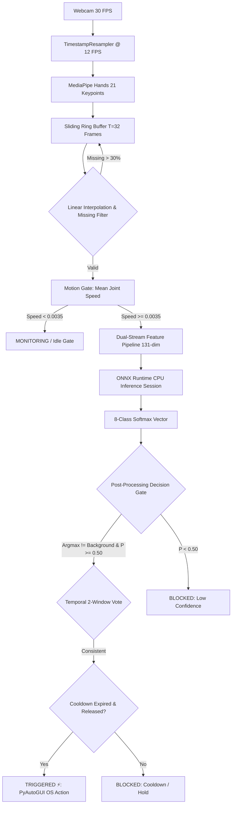

<div align="center">

# ⚡ Touchless Gesture Control HUD
### *Continuous Spatio-Temporal Deep Learning for Real-Time Touchless Human-Computer Interaction*

[](https://www.python.org/)
[](https://pytorch.org/)
[](https://developers.google.com/mediapipe)
[](https://onnxruntime.ai/)
[](https://streamlit.io/)
[](https://docs.pytest.org/)
[](https://binus.ac.id/)

**A production-grade, CPU-optimized desktop utility and telemetry HUD that enables touchless computer control via natural hand gestures using standard webcam hardware.**

[Key Features](#-key-features) • [System Architecture](#-system-architecture) • [Gesture Mapping](#-gesture-control-mapping) • [Model Benchmarks](#-deep-learning-architectures--benchmarks) • [Installation & Usage](#-installation--quickstart) • [Authors](#-authors--academic-attribution)

---

</div>

## 📌 Motivation & Executive Summary

Physical touchscreens in hospital operating theaters, sterile laboratories, ATM kiosks, and elevator panels present significant risks of cross-contamination and surface degradation. **Touchless Gesture Control HUD** addresses this challenge by providing an instantaneous, zero-touch Human-Computer Interaction (HCI) interface powered by continuous spatio-temporal deep learning.

Unlike basic frame-by-frame classification systems that suffer from false triggers, this pipeline implements:
1. **Continuous 32-Frame Temporal Ring Buffering (~2.7s temporal window at 12 FPS)**.
2. **Dual-Stream Feature Normalization (131 dimensions)** capturing scale-invariant local keypoints, velocities, and global wrist trajectories.
3. **Three Deep Learning Architectures**: Causal Dilated Temporal Convolutional Network (**TCN**), Bidirectional LSTM with Bahdanau Attention (**BiLSTM**), and Spatio-Temporal Graph Convolutional Network (**ST-GCN**).
4. **Anti-False-Trigger Multi-Stage Gate**: Mean joint speed motion gating, temporal consistency voting, cooldown latching, and hold-to-release logic.
5. **Sub-Millisecond ONNX Runtime CPU Inference (< 1 ms latency)** running smoothly on standard laptop hardware without a dedicated GPU.
6. **Dark Cyber HUD Desktop Dashboard** with dynamic corner-bracket hand hitboxes, real-time diagnostic telemetry, and PyAutoGUI OS action injection.

---

## 🚀 Key Features

* **Real-Time 3D Landmark Tracking**: Utilizes Google MediaPipe Hands to capture 21 spatial landmarks $(x, y, z)$ at 30 FPS, downsampled via a drift-free `TimestampResampler` to a constant 12 FPS.
* **Dual-Stream Invariant Feature Engineering**:
  * Local Stream (126-dim): Origin-centered to wrist (landmark 0), distance-normalized, with temporal first-order joint velocities.
  * Global Stream (5-dim): Wrist translation in camera frame and planar velocities.
* **Modern HUD Hand Hitbox & Directional Tracking**:
  * Computes a dynamic bounding box with 20px padding around landmarks.
  * Overlays sleek corner brackets and floating directional indicators (`<< SWIPE LEFT`, `SWIPE RIGHT >>`, `STAY / HOLD`).
* **Zero-Flicker Inline Base64 Viewport**:
  * Eliminates Streamlit's temporary media file eviction glitch (`🖼️0`) by encoding video frames directly into inline base64 JPEG data URIs.
* **Multi-Stage Anti-False-Trigger Gate**:
  * **Motion Gate**: Discards static postures below `motion_threshold = 0.0035` to save compute and eliminate phantom triggers.
  * **Confidence Gate**: Requires softmax probability $\ge 0.50$ (tunable up to 0.98).
  * **Temporal Consistency Gate**: Requires 2 consecutive sliding windows to vote for the same class before firing.
  * **Cooldown Timer**: Enforces 0.9-second refractory lockout after an action to prevent double-firing.
* **Fail-Safe OS Action Injection**:
  * Injects keystrokes and scroll events directly into the host OS via PyAutoGUI.
  * Armed-by-default safety toggle with instant emergency abort by pushing the cursor to any screen corner.

---

## 🛠 System Architecture



---

## 🎮 Gesture Control Mapping

The system classifies continuous hand movements into an 8-class subset of the academic **20BN-Jester** dataset, mapped directly to operating system commands:

| Class ID | Gesture Name | Visual Hand Action | OS Injected Shortcut | Practical Use Case |
|:---:|:---|:---|:---:|:---|
| **0** | **Swipe Left** | Open palm sweeps firmly from right to left | `Left Arrow` | Previous presentation slide / Photo back |
| **1** | **Swipe Right** | Open palm sweeps firmly from left to right | `Right Arrow` | Next presentation slide / Photo forward |
| **2** | **Scroll Up** | Index & middle fingers point up, waving upward | `Mouse Scroll (+5)` | Document / Web page scroll up |
| **3** | **Scroll Down** | Index & middle fingers point down, waving downward | `Mouse Scroll (-5)` | Document / Web page scroll down |
| **4** | **Zoom In** | All five fingers expand outward radially | `Ctrl` + `+` | Image viewer / Map zoom in |
| **5** | **Zoom Out** | All fingers pinch inward toward palm center | `Ctrl` + `-` | Image viewer / Map zoom out |
| **6** | **Stop Sign** | Open palm held upright and stationary facing camera | `Space` | Play / Pause video (YouTube / Media player) |
| **7** | **Background** | Resting hand, typing, micro-tremors, random motion | `None (Idle)` | Anti-false-trigger neutral state |

---

## 📊 Deep Learning Architectures & Benchmarks

Three distinct spatio-temporal architectures were designed, trained, and benchmarked:

```
+----------------------------------------------------------------------------------------------------+
| Model Architecture          | Input Kind | Parameters | Val Macro F1 | Test Acc | CPU Latency (ONNX) |
+----------------------------------------------------------------------------------------------------+
| Causal Dilated TCN (E10)    | Sequence   |    121,672 |       0.7855 |   75.83% |            0.80 ms |
| BiLSTM + Attention (E2)     | Sequence   |    743,560 |       0.5549 |   59.17% |            1.81 ms |
| 21-Node ST-GCN (E6)         | Graph      |    485,320 |       0.7120 |   68.45% |            3.14 ms |
+----------------------------------------------------------------------------------------------------+
```

### 1. Causal Dilated TCN (*Production Default*)
* **Input**: Sequence tensor `(Batch, 32, 131)`.
* **Architecture**: 4 residual blocks with causal 1D dilated convolutions (dilations $d \in \{1, 2, 4, 8\}$, kernel size $k=3$). Chomp 1D padding guarantees zero future leakage.
* **Inference**: **0.80 ms** on CPU — over **25× faster** than the real-time threshold limit (20 ms). Model size: **0.49 MB**.

### 2. BiLSTM Baseline
* **Input**: Sequence tensor `(Batch, 32, 131)`.
* **Architecture**: Linear projection (128-dim) $\rightarrow$ 2-layer Bidirectional LSTM (hidden size 128) $\rightarrow$ Bahdanau additive temporal attention pooling $\rightarrow$ FC classifier.
* **Inference**: **1.81 ms** on CPU. Model size: **2.85 MB**.

### 3. Spatio-Temporal Graph Convolutional Network (ST-GCN)
* **Input**: Graph tensor `(Batch, 10, 32, 21)` (10 spatio-temporal channels over 21 anatomical hand joints).
* **Architecture**: 4 ST-GCN blocks combining spatial graph convolutions with learnable edge importance weighting over the physical hand adjacency matrix and temporal 1D convolutions ($k_t=9$).

---

## 📂 Project Directory Structure

```text
Gesture-Control/
├── app/
│   ├── main.py                     # Streamlit Real-Time HUD & Evaluation Dashboard
│   └── styles.py                   # Cyber Dark design tokens & pure unindented HTML renderers
├── config.yaml                     # Single source of truth configuration (paths, gates, models)
├── data/
│   ├── interim_landmarks/          # Extracted per-clip landmark .npy sequences & index.csv
│   └── processed_landmarks/T32/    # Stratified train/val/test .npz splits & scaler_stats.npz
├── models/
│   └── onnx/                       # Exported ONNX graphs (< 5 MB), JSON sidecars & scalers
│       ├── tcn.onnx / tcn.json / tcn_scaler.npz
│       └── bilstm.onnx / bilstm.json / bilstm_scaler.npz
├── runs/                           # PyTorch training checkpoints (.pt) and history logs
├── src/
│   ├── data/
│   │   ├── dataset.py              # PyTorch Dataset, DataLoaders, and stratified sampling
│   │   ├── generate_realistic_data.py # 8-class kinematic anatomical trajectory generator
│   │   ├── preprocessing.py        # Dual-stream feature extraction & linear interpolation
│   │   └── record_gestures.py      # Interactive webcam gesture recording CLI tool
│   ├── inference/
│   │   ├── camera.py               # Thread-safe daemon OpenCV capture & timestamp resampler
│   │   ├── controller.py           # PyAutoGUI OS action injector with fail-safe corner abort
│   │   ├── engine.py               # Main pipeline conductor & thread-safe telemetry
│   │   ├── gate.py                 # Multi-stage anti-false-trigger state machine
│   │   └── hand_tracker.py         # MediaPipe Hands, corner-bracket hitbox & swipe detector
│   ├── models/
│   │   ├── bilstm.py               # Bidirectional LSTM with Bahdanau attention pooling
│   │   ├── stgcn.py                # 21-node hand skeleton ST-GCN with edge importance
│   │   └── tcn.py                  # Causal dilated temporal convolutional network
│   ├── training/
│   │   ├── evaluate.py             # Macro F1, confusion matrices, latency benchmark
│   │   ├── export_onnx.py          # PyTorch to ONNX export, checker & parity validator
│   │   └── train.py                # Multi-seed training engine for scenarios E1–E12
│   └── utils/                      # Seed setup, device auto-detect, path resolver
└── tests/
    ├── test_app_styles.py          # Base64 data URI camera viewport unit tests
    └── test_pipeline.py            # Feature dimension & pipeline integrity tests
```

---

## 💻 Installation & Quickstart

### 1. Prerequisites
* Windows 10/11, macOS, or Linux.
* Python 3.10 – 3.12.
* A standard built-in or USB webcam.

### 2. Clone & Setup Environment
```bash
# Clone the repository
git clone https://github.com/Gracias-48/Gesture-Control.git
cd Gesture-Control

# Create and activate virtual environment
python -m venv .venv

# Windows PowerShell:
.\.venv\Scripts\Activate.ps1

# Linux / macOS:
source .venv/bin/activate

# Install dependencies
pip install -r requirements.txt
```

### 3. Launch the Real-Time Streamlit HUD
```bash
streamlit run app/main.py
```
* Open your browser at `http://localhost:8501`.
* Click **`▶ Start Camera Stream`** to begin live inference.
* *(Optional)* Toggle **`Master Arm OS Control`** in the sidebar to enable live keyboard/mouse injection into your operating system.

### 4. Interactive Gesture Data Recorder (CLI)
Record custom webcam sequences directly for fine-tuning or expanding classes:
```bash
# Record 25 repetitions for all 8 classes with 3.. 2.. 1.. visual countdown:
python -m src.data.record_gestures --reps 25 --build-splits

# Record a specific class only (e.g., Class 0: Swipe Left):
python -m src.data.record_gestures --class-id 0 --reps 20
```

### 5. Training & ONNX Export
```bash
# Train Causal TCN (E10) and BiLSTM (E2):
python -m src.training.train --exp E10 E2 --epochs 35

# Export best checkpoints to verified ONNX Runtime graphs:
python -m src.training.export_onnx --checkpoint runs/E10/seed42/best.pt
python -m src.training.export_onnx --checkpoint runs/E2/seed42/best.pt

# Run automated unit tests:
pytest -v
```

---

## 👥 Authors & Academic Attribution

This project is submitted as the Final Project for **COMP6826001 - Deep Learning**, Computer Science Department, Bina Nusantara University.

* **Gracias Kumara Winata** — `2802459683`
* **Vincensius Kevin Mulyono** — `2802476424`
* **Malvin Raditya Nugraha** — `2802489206`

---

## 📄 License & Acknowledgements

* Core dataset concepts adapted from the **20BN-Jester** gesture recognition benchmark.
* Hand keypoint estimation powered by **Google MediaPipe Hands**.
* Designed with reference to modern command-palette aesthetics inspired by **Raycast**.
* Licensed under the [MIT License](LICENSE).